<p align="center">
  <picture>
    <source media="(prefers-color-scheme: dark)" srcset="marketing/launch/github/banner-escuro.png">
    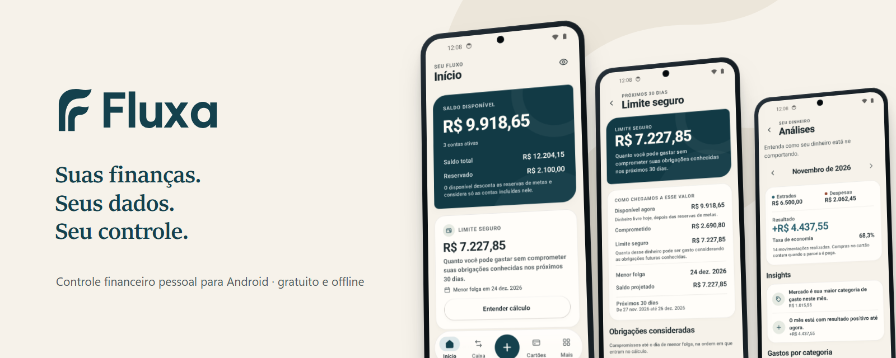
  </picture>
</p>

<p align="center">
  <a href="README.md">Português</a> · <strong>English</strong>
</p>

<p align="center">
  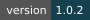
  
  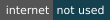
  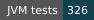
</p>

# Fluxa

**Personal finance for Android. Free, no account, no internet.**

Fluxa keeps track of accounts, income, expenses, credit cards, installment purchases, subscriptions and goals. From that data it answers a practical question: *how much can I spend without putting at risk what is already committed for the next 30 days?*

Your data stays on your phone. The app has no server, no sign-in and no permission to access the internet.

> The app's interface is in Brazilian Portuguese and amounts are in Brazilian reais (BRL).

## Why it exists

Fluxa started as a web application with a server, a database and sign-in. For one person's finances, that brought more cost and risk than value: financial data on a server, sessions to maintain and a dependency on connectivity.

So it was rebuilt as a native, offline Android app. Everything is calculated on the device, and backups are encrypted files that you keep wherever you like.

It is an independent, free project maintained by one developer. It is not a bank, not a subscription service and does not give financial advice.

## Download

<p>
  <a href="https://github.com/matssgit/fluxa-app/releases/latest"><strong>⬇ Download the latest version</strong></a>
  &nbsp;·&nbsp; current version: <a href="https://github.com/matssgit/fluxa-app/releases/tag/v1.0.2">1.0.2</a> (<code>Fluxa-1.0.2.apk</code>, 22.6 MB)
</p>

The APK is free, and its SHA-256 checksum is on the release page. Fluxa is distributed only through GitHub and is not on Google Play.

- Requires **Android 11 or later**.
- **Download only from the official [Releases](https://github.com/matssgit/fluxa-app/releases) page.** Copies from other sites may have been modified.
- Installing, updating and backing up: see [Installation](#installation).

## Screens

<table>
  <tr>
    <td align="center">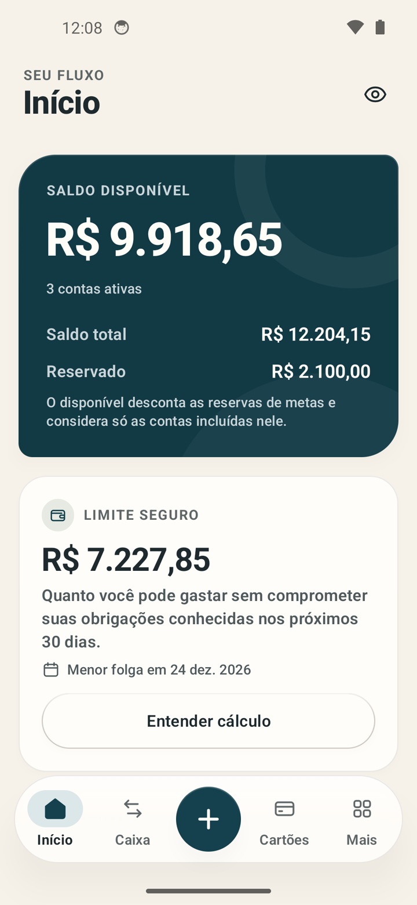<br><sub>Home</sub></td>
    <td align="center">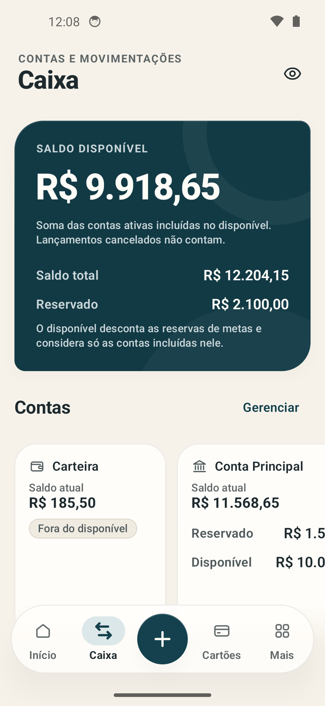<br><sub>Cash</sub></td>
    <td align="center">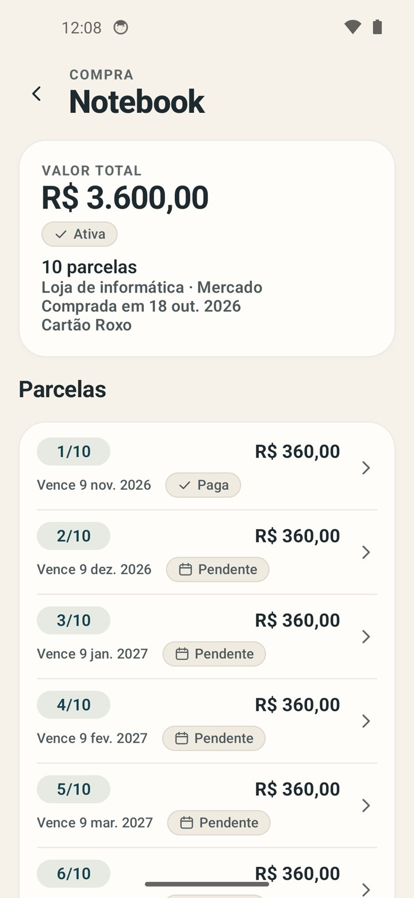<br><sub>Installment purchases</sub></td>
    <td align="center">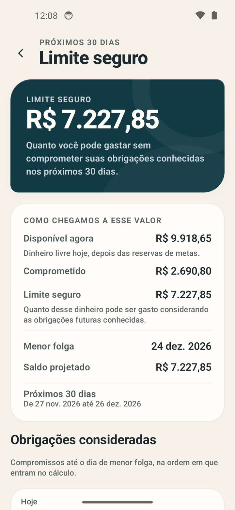<br><sub>Safe to spend</sub></td>
  </tr>
  <tr>
    <td align="center">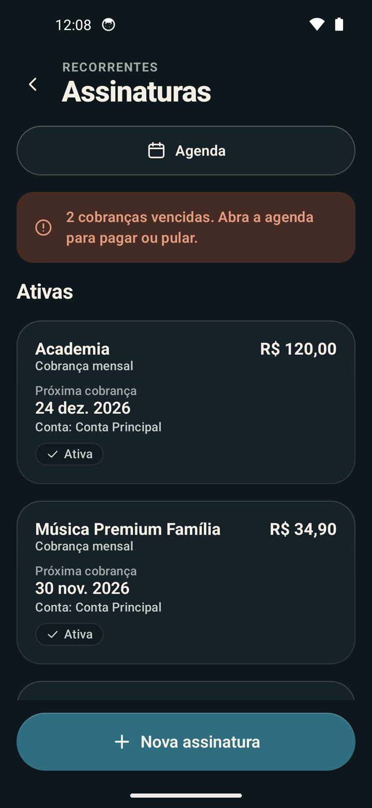<br><sub>Subscriptions</sub></td>
    <td align="center">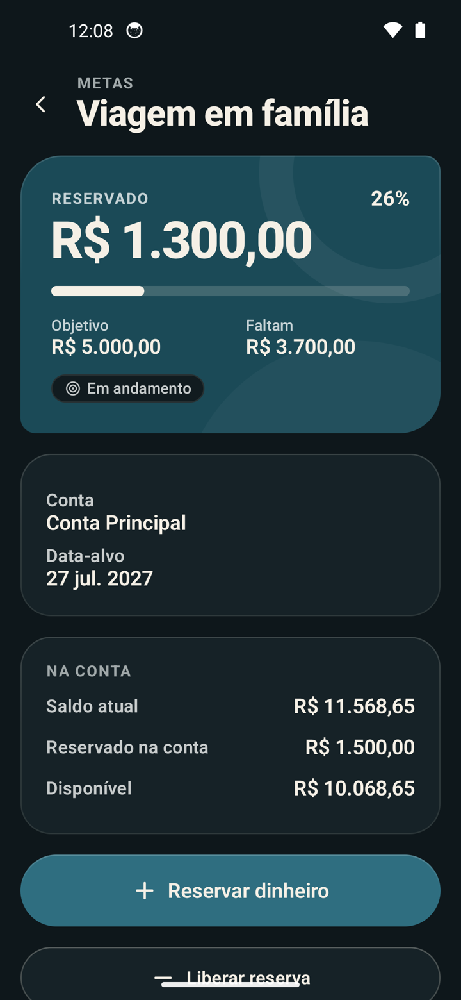<br><sub>Goals and reserves</sub></td>
    <td align="center">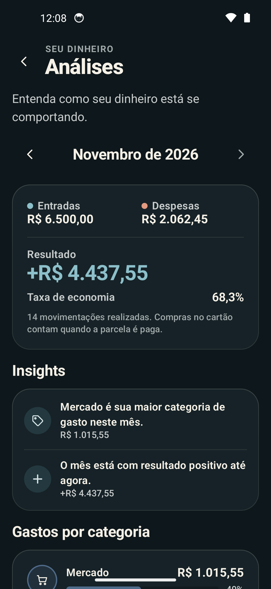<br><sub>Analytics</sub></td>
    <td align="center">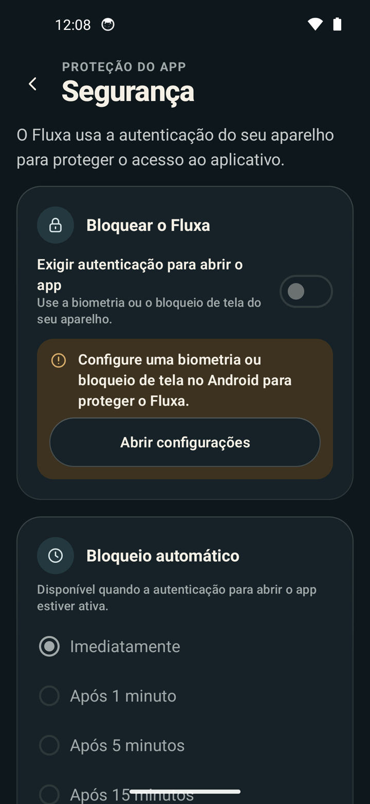<br><sub>Security</sub></td>
  </tr>
</table>

<sub>Screenshots of the real app, taken on an emulator with fictional data.</sub>

## Features

**Everyday**
- Checking, wallet and savings accounts, with an opening balance and the option to leave an account out of the available balance.
- Income and expenses by category, with a filterable history.
- Your own income and expense categories.

**Cards and commitments**
- Credit cards with a limit, closing day and due day. The available limit is derived from what is committed.
- One-off or installment purchases, with the installment schedule.
- Paying an installment from an account, with undo.
- Monthly or yearly subscriptions, paid from an account or charged to a card, with a billing agenda.

**Planning**
- Goals with reserves tied to an account. Reserved money leaves the available balance without being counted twice.
- **Safe to spend**: how much you can spend today without running short on the installments and subscriptions due in the next 30 days, including the day with the least slack.
- **Analytics**: monthly summary, spending by category, the last six months, a 30-day projection, subscription cost and automatic observations.

**Privacy**
- Works without internet, an account or a server.
- App lock using Android's own screen lock (biometrics, PIN, pattern or password), with auto-lock.
- Optional protection against screenshots and the Recents preview.
- Option to hide amounts on screen.
- Manual, password-encrypted backups (`.fluxa` files). Before restoring, the app first saves a preventive copy of the current data.
- Light, dark or automatic theme.

Details and limitations for each feature: [docs/FEATURES.md](docs/FEATURES.md) (Portuguese).

## What sets it apart

- **Nothing leaves the device.** No server, no account and no internet permission, and every APK is audited.
- **Money as whole cents.** No financial calculation uses floating point, and overflows are detected instead of being rounded silently.
- **No double counting.** A card purchase becomes an expense once, when the installment is paid. A goal reserve reduces the available balance without disappearing from the account balance.
- **Projections from what you recorded.** Safe to spend only considers the installments and subscriptions you entered. It does not guess spending or use external data.
- **Atomic operations.** Paying an installment, charging a subscription or restoring a backup happens completely or not at all.
- **Tested.** 326 JVM tests and an instrumented suite run offline on five combinations of screen and font size.

## Technology

Kotlin 1.9.24 · Jetpack Compose (BOM 2024.06.00) with Material 3 · Navigation Compose · Room 2.6.1 on SQLite · DataStore Preferences · Coroutines and Flow · AndroidX Biometric · Gson (backup format) · Gradle 8.9 with Android Gradle Plugin 8.5.2 · JDK 17.

No networking, analytics, advertising or tracking libraries.

## Architecture

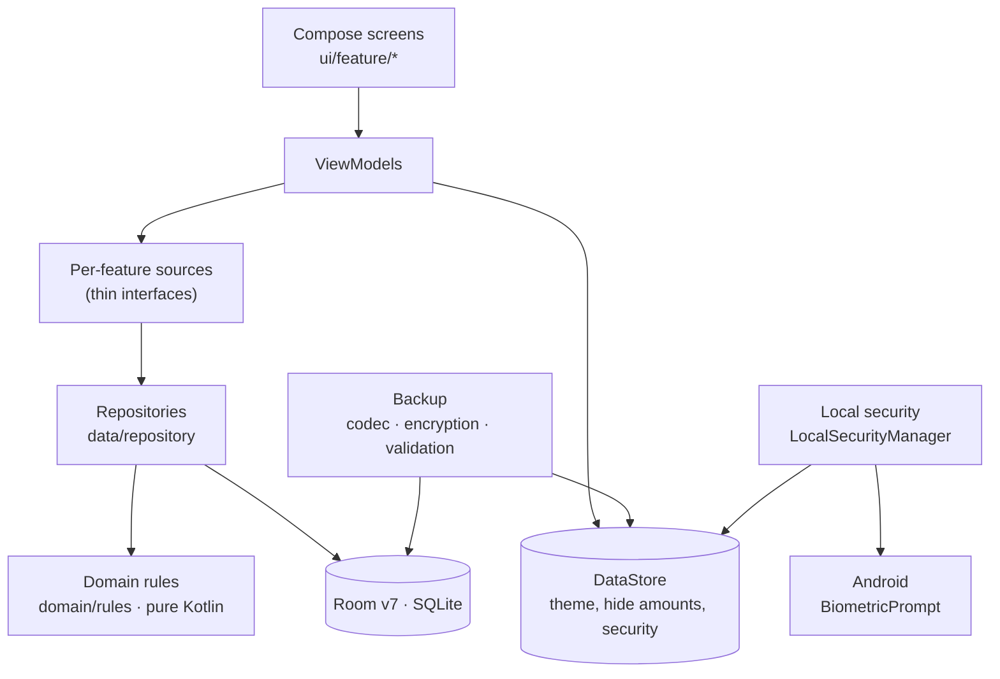

Repositories open database transactions and call the domain rules, which are pure functions tested without Android. Screens observe `Flow`s that update when tables change. Full write-up: [docs/ARCHITECTURE.md](docs/ARCHITECTURE.md) (Portuguese).

## Engineering decisions

| Decision | Why |
| --- | --- |
| Amounts in cents (`Long`) with exact sums | No rounding errors, and overflows are detected |
| Financial dates as `LocalDate` in the device time zone | A purchase belongs to the day you made it, not to a UTC instant |
| Card limit derived from open installments | There is no stored "used limit" that could drift |
| Reserves as movements of a goal tied to an account | The available balance excludes the reserve; the account balance stays real |
| Installment payment linked to exactly one transaction | Prevents paying twice and makes undo safe |
| Safe to spend as the lowest projected balance in the horizon | Shows the worst day, not just the final balance |
| Explicit migrations 1 to 7 with exported schemas | Updating the app does not erase data |
| Versioned backup format, validated before writing | An invalid file is rejected before touching the database |

Financial rules with examples: [docs/FINANCIAL_DOMAIN.md](docs/FINANCIAL_DOMAIN.md) (Portuguese).

## Quality

- **326 JVM tests** covering domain, repositories, ViewModels, backup and formatting.
- **Instrumented suite with 200 cases.** 173 run by default and 27 only on demand, such as upgrade and process-death tests. It ran with no network and no failures on five combinations: 320×640, 360, 390 in dark theme, 412 and 320 with 130% font size.
- **Upgrades tested** from each version to the next without uninstalling, comparing the whole database before and after.
- **Migrations** verified from 1 to 7 against the exported schemas.
- **Backups** tested end to end, including corrupted files, wrong passwords and a real restore through Android's file picker.
- **Lint** clean in debug and release.
- Tested on emulators and on the developer's Samsung Galaxy S23.

How to run the tests and what each suite covers: [docs/TESTING.md](docs/TESTING.md) (Portuguese).

## Installation

1. Download the `.apk` file from the [Releases](https://github.com/matssgit/fluxa-app/releases) page. You can check it against the published SHA-256.
2. Open the file on Android. If asked, allow installing unknown apps for the app that opened the APK, such as your browser or file manager.
3. Tap **Install**.

**To update**, install the new version over the old one and accept **Update**. Do not uninstall first.

> [!IMPORTANT]
> Data lives only on the device. **Uninstalling Fluxa deletes everything.** Before updating or switching phones, make a backup in **Mais → Backup e restauração** and keep the file and its password somewhere safe. Without the password the backup cannot be opened.

## For developers

Requirements: JDK 17 and the Android SDK with platform 34 and build-tools 34. The Gradle Wrapper downloads Gradle 8.9, and Android Studio is optional.

```bash
git clone https://github.com/matssgit/fluxa-app.git
cd fluxa-app/android
./gradlew testDebugUnitTest          # JVM tests
./gradlew assembleDebug              # development APK
./gradlew connectedDebugAndroidTest  # instrumented tests (emulator or device)
```

On Windows, use `gradlew.bat`. Full guide: [docs/DEVELOPMENT.md](docs/DEVELOPMENT.md) (Portuguese).

> [!NOTE]
> This repository also holds the original web version of Fluxa (`frontend/` and `backend/`). It is described in [docs/web/README.md](docs/web/README.md) and is not the current focus.

## Roadmap

Fluxa evolves with real use and feedback, without fixed dates.

- **Now:** version 1.0.2, the first public distribution.
- **Maintenance:** fixes reported by users, compatibility with new Android versions and a permanent signing key for public distribution.
- **Under consideration:** ideas that come in through issues, evaluated one by one.

More in [docs/ROADMAP.md](docs/ROADMAP.md) (Portuguese).

## Contributing

Bug reports, suggestions, usage questions, documentation fixes and code contributions are welcome. See [CONTRIBUTING.md](CONTRIBUTING.md) (Portuguese). Issues in English are fine.

> [!WARNING]
> Do not post real financial data, passwords, backups or personal information in issues. Use made-up values.

To report a vulnerability, follow [SECURITY.md](SECURITY.md) instead of opening a public issue.

## License

[MIT](LICENSE), © 2026 Matheus Santana. You may use, study, modify and redistribute the code, keeping the copyright notice.

The license covers the Android and web code. Third-party components and the web version's icons (`frontend/public`), whose origin has not been confirmed, are excluded. See [THIRD_PARTY_NOTICES.md](THIRD_PARTY_NOTICES.md).

## Author

Built by **Matheus Santana**, software developer.

[Portfolio](https://matheusantanadev.vercel.app/) · [GitHub](https://github.com/matssgit)
