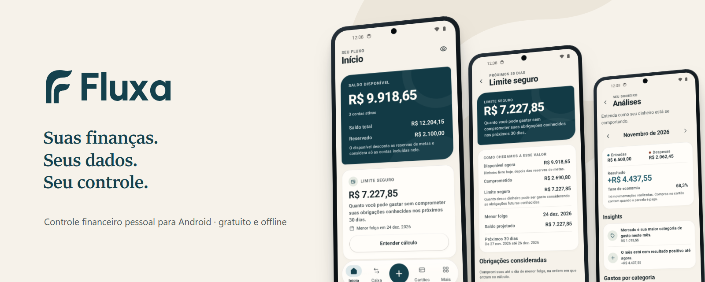
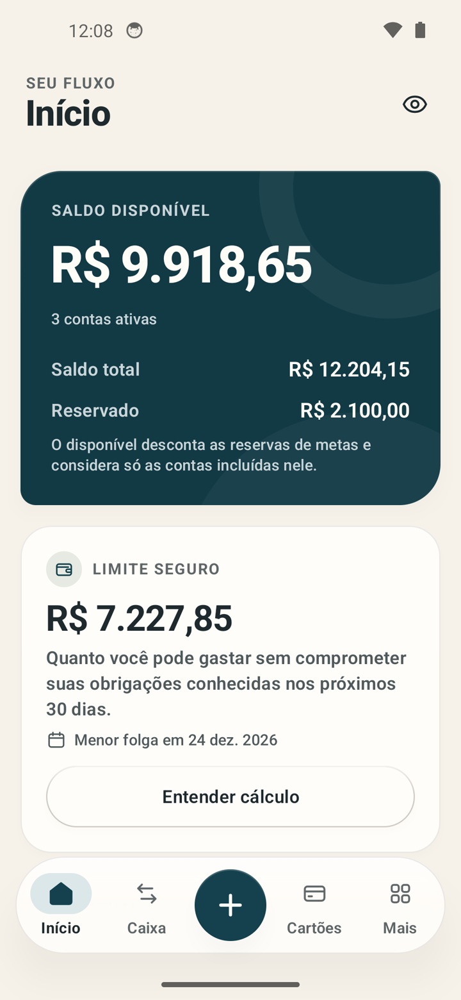
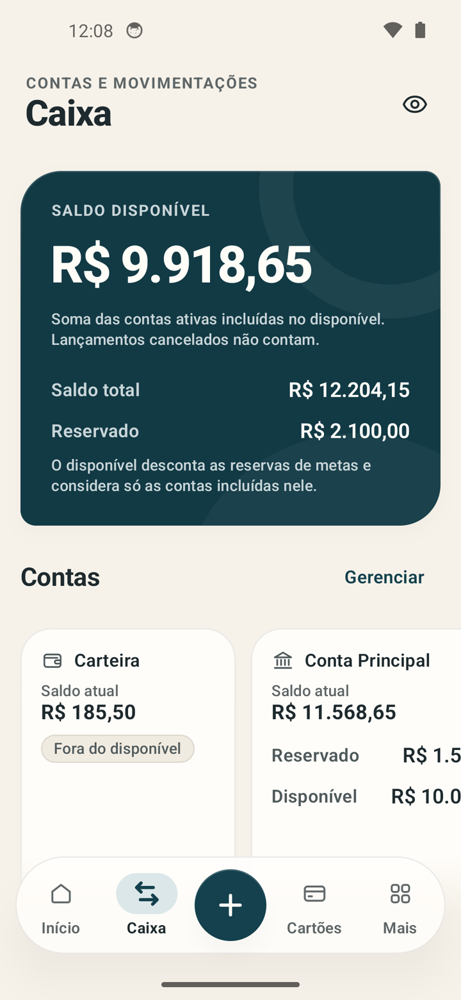
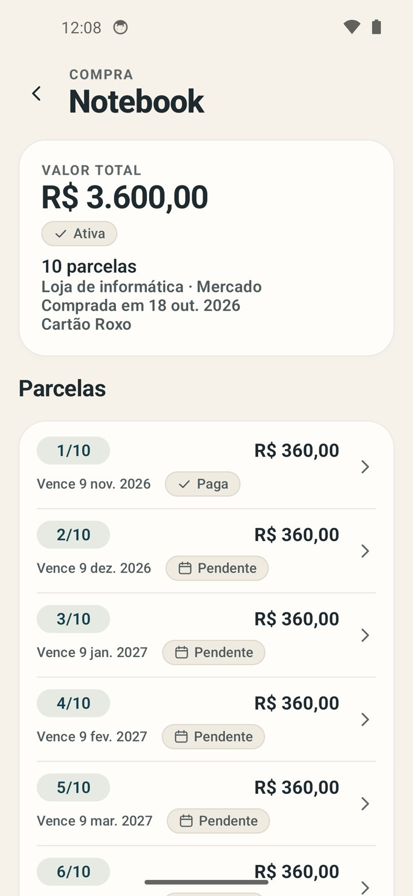
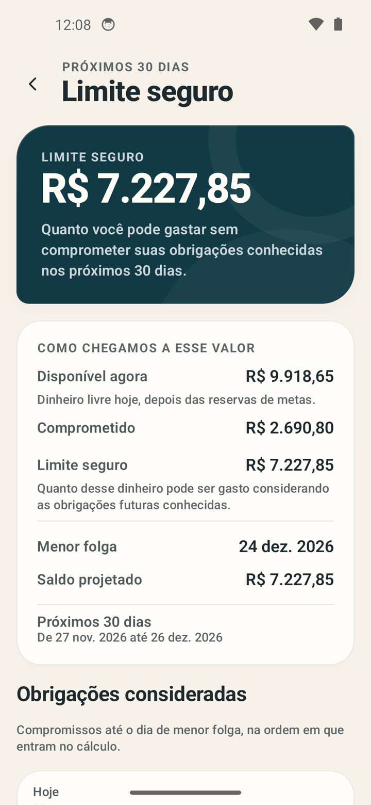
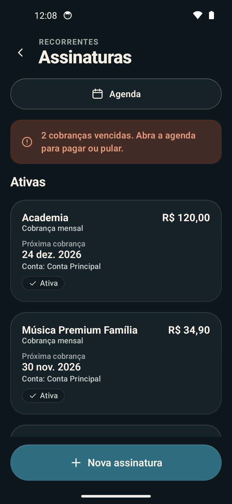
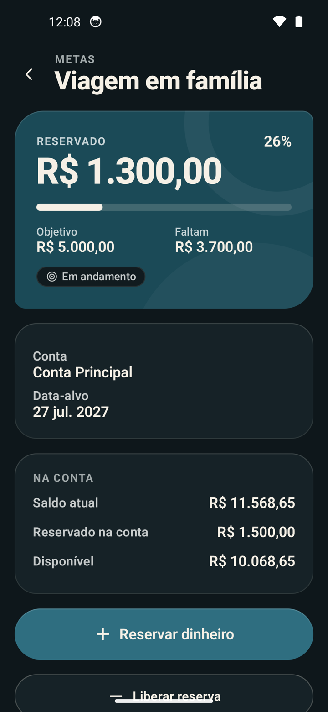
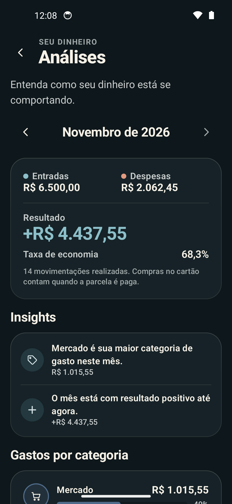
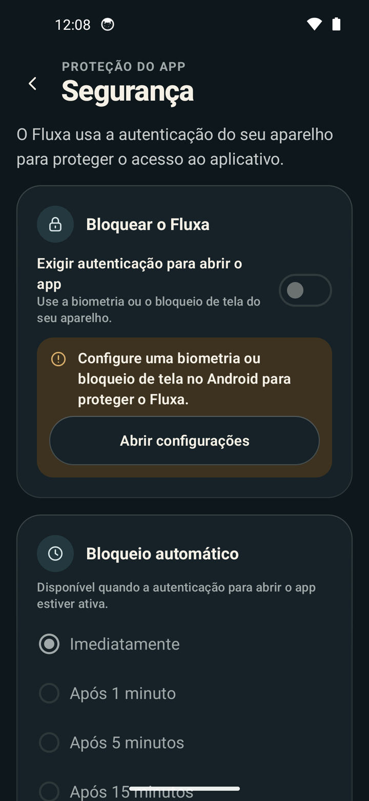
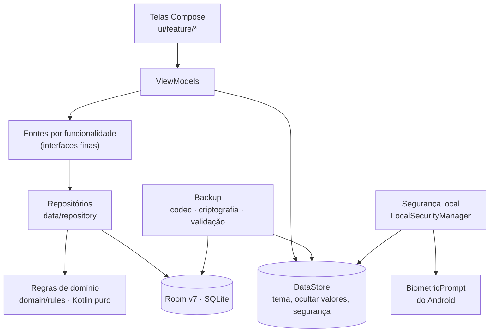

<p align="center">
  <picture>
    <source media="(prefers-color-scheme: dark)" srcset="marketing/launch/github/banner-escuro.png">
    
  </picture>
</p>

<p align="center">
  <strong>Português</strong> · <a href="README.en.md">English</a>
</p>

<p align="center">
  
  
  
  
</p>

# Fluxa

**Controle financeiro pessoal para Android. Gratuito, sem conta e sem internet.**

O Fluxa organiza contas, receitas, despesas, cartões de crédito, compras parceladas, assinaturas e metas. Com esses dados, ele responde a uma pergunta prática: *quanto posso gastar sem comprometer o que já está combinado para os próximos 30 dias?*

Os dados ficam no seu aparelho. O aplicativo não tem servidor, não pede login e não tem permissão de acesso à internet.

## Por que existe

O Fluxa começou como uma aplicação web com servidor, banco de dados e login. Para controlar as finanças de uma pessoa, isso trazia mais custo e risco do que valor: dados financeiros em um servidor, sessão para manter e dependência de conexão.

Por isso ele foi reconstruído como um aplicativo Android nativo e offline. Tudo é calculado no aparelho, e o backup é um arquivo criptografado que você guarda onde quiser.

É um projeto independente e gratuito, mantido por um desenvolvedor. Não é um banco, não é um serviço por assinatura e não dá recomendação financeira.

## Download

> [!NOTE]
> **Ainda não há versão pública publicada.** O APK será disponibilizado na página de [Releases](https://github.com/matssgit/fluxa-app/releases) deste repositório, com o checksum SHA-256. O Fluxa não está na Google Play.

- Requer **Android 11 ou superior**.
- Instalação, atualização e backup: veja [Instalação](#instalação).

## Telas

<table>
  <tr>
    <td align="center"><br><sub>Início</sub></td>
    <td align="center"><br><sub>Caixa</sub></td>
    <td align="center"><br><sub>Compras parceladas</sub></td>
    <td align="center"><br><sub>Limite seguro</sub></td>
  </tr>
  <tr>
    <td align="center"><br><sub>Assinaturas</sub></td>
    <td align="center"><br><sub>Metas e reservas</sub></td>
    <td align="center"><br><sub>Análises</sub></td>
    <td align="center"><br><sub>Segurança</sub></td>
  </tr>
</table>

<sub>Capturas do aplicativo real, feitas em emulador com dados fictícios.</sub>

## Funcionalidades

**Dia a dia**
- Contas corrente, carteira e poupança, com saldo inicial e a opção de deixá-las fora do saldo disponível.
- Receitas e despesas por categoria, com histórico filtrável no Caixa.
- Categorias próprias de entrada e de saída.

**Cartões e compromissos**
- Cartões com limite, dia de fechamento e dia de vencimento. O limite disponível é calculado a partir do que está comprometido.
- Compras à vista ou parceladas, com o cronograma das parcelas.
- Pagamento de parcela a partir de uma conta, com opção de desfazer.
- Assinaturas mensais ou anuais, pagas por uma conta ou cobradas no cartão, com agenda de cobranças.

**Planejamento**
- Metas com reservas vinculadas a uma conta. O dinheiro reservado sai do saldo disponível sem ser contado duas vezes.
- **Limite seguro**: quanto pode ser gasto hoje sem faltar dinheiro para as parcelas e assinaturas dos próximos 30 dias. Também mostra o dia de menor folga.
- **Análises**: resumo do mês, gastos por categoria, últimos seis meses, projeção de 30 dias, custo das assinaturas e observações automáticas.

**Privacidade**
- Funciona sem internet, sem conta e sem servidor.
- Bloqueio pelo próprio desbloqueio do Android (biometria, PIN, padrão ou senha), com bloqueio automático.
- Proteção opcional contra capturas de tela e contra a prévia em Recentes.
- Opção de ocultar os valores na tela.
- Backup manual criptografado com senha (arquivo `.fluxa`). Ao restaurar, o app guarda antes uma cópia preventiva dos dados atuais.
- Tema claro, escuro ou automático.

Detalhes e limitações de cada uma: [docs/FEATURES.md](docs/FEATURES.md).

## O que o diferencia

- **Nada sai do aparelho.** Não há servidor, conta nem permissão de internet, e o APK é auditado a cada versão.
- **Dinheiro em centavos inteiros.** Nenhum cálculo financeiro usa ponto flutuante, e estouros são detectados em vez de arredondados em silêncio.
- **Sem contagem dupla.** Uma compra no cartão vira despesa quando a parcela é paga, uma única vez. A reserva de uma meta reduz o disponível sem sumir do saldo da conta.
- **Projeção a partir do que você registrou.** O Limite seguro considera apenas as parcelas e assinaturas cadastradas. Ele não estima gastos nem usa dados externos.
- **Operações atômicas.** Pagar uma parcela, cobrar uma assinatura ou restaurar um backup acontece por inteiro ou não acontece.
- **Testado.** 326 testes JVM e uma suíte instrumentada executada offline em cinco combinações de tela e tamanho de fonte.

## Tecnologia

Kotlin 1.9.24 · Jetpack Compose (BOM 2024.06.00) com Material 3 · Navigation Compose · Room 2.6.1 sobre SQLite · DataStore Preferences · Coroutines e Flow · AndroidX Biometric · Gson (formato do backup) · Gradle 8.9 com Android Gradle Plugin 8.5.2 · JDK 17.

Sem bibliotecas de rede, analytics, anúncios ou rastreamento.

## Arquitetura



Os repositórios abrem as transações no banco e chamam as regras de domínio, que são funções puras, testadas sem Android. As telas observam `Flow`s que se atualizam quando as tabelas mudam. Explicação completa: [docs/ARCHITECTURE.md](docs/ARCHITECTURE.md).

## Decisões de engenharia

| Decisão | Por quê |
| --- | --- |
| Valores em centavos (`Long`) com somas exatas | Evitar erro de arredondamento e detectar estouro |
| Datas financeiras em `LocalDate`, no fuso do aparelho | O dia de uma compra é o dia em que você a fez, não um instante em UTC |
| Limite do cartão derivado das parcelas em aberto | Não existe um "limite usado" armazenado que possa divergir |
| Reservas como movimentos de uma meta ligada a uma conta | O disponível desconta a reserva, e o saldo da conta continua real |
| Pagamento de parcela com vínculo único à transação | Impede pagar duas vezes e permite desfazer com segurança |
| Limite seguro como o menor saldo projetado no horizonte | Mostra o pior dia, não só o saldo final |
| Migrations explícitas de 1 a 7, com schema exportado | Atualizar o app não apaga dados |
| Backup com formato versionado e validação antes de gravar | Um arquivo inválido é recusado antes de tocar no banco |

Regras financeiras com exemplos: [docs/FINANCIAL_DOMAIN.md](docs/FINANCIAL_DOMAIN.md).

## Qualidade

- **326 testes JVM** cobrindo domínio, repositórios, ViewModels, backup e formatação.
- **Suíte instrumentada com 200 casos.** 173 rodam por padrão e 27 só sob demanda, como os de atualização e de processo encerrado. Ela foi executada sem rede e sem falhas em cinco combinações: 320×640, 360, 390 no tema escuro, 412 e 320 com fonte em 130%.
- **Atualização testada** de cada versão para a seguinte, sem desinstalar, comparando o banco inteiro antes e depois.
- **Migrations** verificadas de 1 a 7 sobre os schemas exportados.
- **Backup** testado de ponta a ponta, inclusive com arquivo corrompido, senha errada e restauração real pelo seletor de arquivos do Android.
- **Lint** sem avisos em debug e release.
- Testado em emulador e no Samsung Galaxy S23 do desenvolvedor.

Como rodar os testes e o que cada suíte cobre: [docs/TESTING.md](docs/TESTING.md).

## Instalação

1. Baixe o arquivo `.apk` na página de [Releases](https://github.com/matssgit/fluxa-app/releases). Se quiser, confira o SHA-256 publicado junto.
2. Abra o arquivo no Android. Se pedir, permita a instalação de apps desconhecidos para o aplicativo que abriu o APK, como o navegador ou o gerenciador de arquivos.
3. Toque em **Instalar**.

**Para atualizar**, instale a versão nova por cima e aceite **Atualizar**. Não desinstale antes.

> [!IMPORTANT]
> Os dados ficam só no aparelho. **Desinstalar o Fluxa apaga tudo.** Antes de atualizar ou trocar de celular, faça um backup em **Mais → Backup e restauração** e guarde o arquivo e a senha em um lugar seguro. Sem a senha, o backup não pode ser aberto.

## Para desenvolvedores

Requisitos: JDK 17 e Android SDK com a plataforma 34 e as build-tools 34. O Gradle Wrapper baixa o Gradle 8.9, e o Android Studio é opcional.

```bash
git clone https://github.com/matssgit/fluxa-app.git
cd fluxa-app/android
./gradlew testDebugUnitTest          # testes JVM
./gradlew assembleDebug              # APK de desenvolvimento
./gradlew connectedDebugAndroidTest  # testes instrumentados (emulador ou aparelho)
```

No Windows, use `gradlew.bat`. Guia completo: [docs/DEVELOPMENT.md](docs/DEVELOPMENT.md).

> [!NOTE]
> Este repositório também guarda a versão web original do Fluxa (`frontend/` e `backend/`). Ela está documentada em [docs/web/README.md](docs/web/README.md) e não é o foco atual do projeto.

## Roadmap

O Fluxa evolui conforme o uso real e o feedback recebido, sem datas fixas.

- **Agora:** versão 1.0.2, a primeira distribuída publicamente.
- **Manutenção:** correções relatadas por quem usa, compatibilidade com novas versões do Android e assinatura definitiva para distribuição pública.
- **Em consideração:** ideias que chegarem pelas issues, avaliadas uma a uma.

Mais em [docs/ROADMAP.md](docs/ROADMAP.md).

## Contribuir

Relatos de bugs, sugestões, dúvidas de uso, melhorias na documentação e contribuições de código são bem-vindos. Veja [CONTRIBUTING.md](CONTRIBUTING.md).

> [!WARNING]
> Não publique dados financeiros reais, senhas, backups ou informações pessoais em issues. Use valores fictícios.

Para relatar uma vulnerabilidade, siga [SECURITY.md](SECURITY.md) em vez de abrir uma issue pública.

## Documentação

[Funcionalidades](docs/FEATURES.md) · [Arquitetura](docs/ARCHITECTURE.md) · [Domínio financeiro](docs/FINANCIAL_DOMAIN.md) · [Modelo de dados](docs/DATA_MODEL.md) · [Backup e segurança](docs/BACKUP_AND_SECURITY.md) · [Desenvolvimento](docs/DEVELOPMENT.md) · [Testes](docs/TESTING.md) · [Processo de release](docs/RELEASE_PROCESS.md) · [Privacidade](PRIVACY.md) · [Aviso](DISCLAIMER.md) · [Changelog](CHANGELOG.md)

## Licença

A licença ainda não foi definida. Enquanto não houver um arquivo `LICENSE`, o código pode ser lido, mas não há permissão formal para reutilizá-lo nem redistribuí-lo.

## Autor

Feito por **Matheus Santana**, desenvolvedor de software.

[Portfólio](https://matheusantanadev.vercel.app/) · [GitHub](https://github.com/matssgit)
