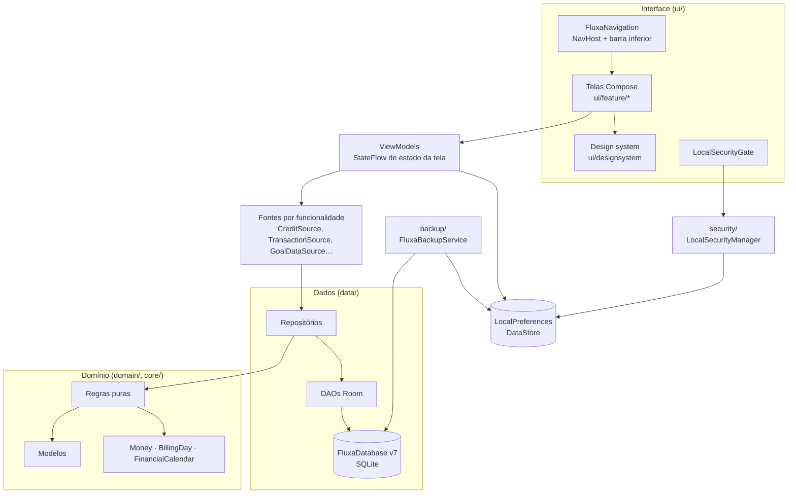
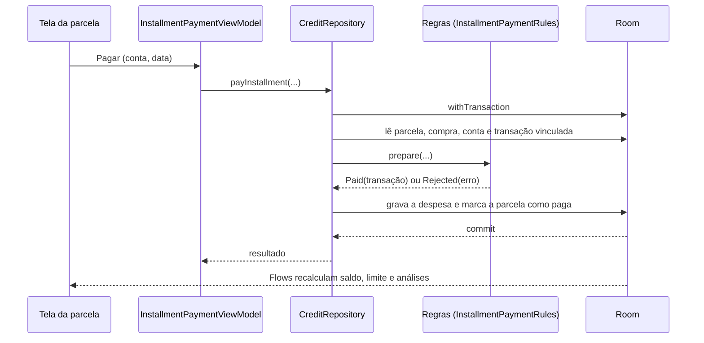

# Arquitetura

O Fluxa é um aplicativo Android de módulo único (`android/app`), escrito em Kotlin com Jetpack Compose. Ele não tem servidor: toda a lógica roda no aparelho, e os dados ficam em um banco Room e em um DataStore locais.

## Visão geral



## Camadas

### `core/`
Tipos básicos sem dependência de Android:
- `Money`: valor em centavos (`Long`) com soma e subtração exatas (`Math.addExact`).
- `BillingDay`: dia de cobrança de 1 a 31, ajustado ao último dia de meses curtos.
- `FinancialCalendar`: o "hoje" financeiro, no fuso do aparelho, com relógio injetável nos testes.
- `LocalPreferences`: o DataStore com o tema, a opção de ocultar valores e as configurações de segurança.

### `domain/`
- `model/`: classes de dados imutáveis (conta, transação, cartão, compra, parcela, assinatura, meta, resultados).
- `rules/`: as regras financeiras como **objetos e funções puras**. Exemplos: `BalanceCalculator`, `CreditPurchaseRules`, `CreditBillingCalendar`, `InstallmentSplitter`, `InstallmentPaymentRules`, `SubscriptionCalendar`, `GoalRules`, `SafeToSpendCalculator` e `FinancialAnalyticsCalculator`.

As regras recebem dados e devolvem um resultado tipado (`Saved`/`Rejected` com um erro de enum). Elas não acessam o banco, o relógio do sistema nem o Android. Por isso são testadas diretamente na JVM.

Não existe uma camada separada de casos de uso. Os repositórios fazem esse papel: abrem a transação, leem o estado, chamam a regra e gravam o resultado.

### `data/`
- `database/`: `FluxaDatabase` (Room, versão 7), entidades, DAOs, mappers entidade↔domínio, migrations 1→7 e *triggers* de proteção (`CategoryKindGuard`, `SubscriptionGuards` e as guardas de metas).
- `repository/`: um repositório por área. Cada operação que muda dados roda dentro de `database.withTransaction { … }`.

As leituras são expostas como `Flow`, ligados ao *invalidation tracker* do Room. Quando uma tabela relevante muda, a tela recalcula. Por exemplo, o Limite seguro observa contas, transações, metas, assinaturas e cartões.

### `ui/`
- `FluxaNavigation`: `NavHost` com as abas Início, Caixa, Cartões e Mais, e as rotas de cada funcionalidade.
- `ui/feature/<área>/`: telas (`*Screens.kt`), ViewModels (`*ViewModels.kt`) e uma interface fina de acesso a dados (`*Source`/`*DataSource`), que permite testar o ViewModel com uma fonte falsa.
- `ui/designsystem/`: cores, tipografia, formas, ícones próprios e componentes (`FluxaButton`, `FluxaAmount`, `FluxaSheet`…). Não usa `material-icons-extended`.
- `LocalSecurityGate`: cobre o conteúdo enquanto o app estiver bloqueado.

### `backup/`
`FluxaBackupService` coordena a exportação e a restauração. `BackupCodec` faz a serialização, `BackupCrypto` a criptografia, `BackupValidator` a validação e `BackupPersistence` grava no Room. `BackupDocuments` faz a ponte com o seletor de arquivos do Android (SAF). Detalhes em [BACKUP_AND_SECURITY.md](BACKUP_AND_SECURITY.md).

### `security/`
`LocalSecurityManager` é a máquina de estados do bloqueio: inicializando, desativado, bloqueado ou desbloqueado. Ela decide quando bloquear com base no tempo em segundo plano, medido por `elapsedRealtime`. `AndroidLocalSecurity` usa o `BiometricPrompt` com biometria forte ou credencial do aparelho. A `MainActivity` aplica `FLAG_SECURE` quando a proteção de tela está ligada.

## Injeção de dependências

Manual. `FluxaApplication` cria, sob demanda (`by lazy`), o banco, as preferências, os repositórios, o serviço de backup e o gerenciador de segurança. Os ViewModels recebem as dependências por *factories*. Não há Hilt, Koin nem reflexão.

## Fluxo de uma operação: pagar uma parcela



Se qualquer passo falhar, nada é gravado. O índice único em `financial_transactions.installmentId` impede uma segunda despesa para a mesma parcela, mesmo em caso de toque duplo.

## Decisões e motivos

| Decisão | Motivo |
| --- | --- |
| Offline, sem servidor | Privacidade e simplicidade: não há conta para proteger nem servidor para manter |
| Regras puras separadas dos repositórios | Testes rápidos e determinísticos, sem emulador |
| Transação de banco por operação | Consistência: um pagamento cria a despesa e marca a parcela juntos |
| Triggers no SQLite além das validações em Kotlin | Uma segunda barreira contra estados inválidos, inclusive em restaurações |
| Valores derivados, não armazenados | Saldo, limite usado, reservado e Limite seguro são sempre recalculados a partir dos fatos |
| Formato de backup congelado (v1), separado das entidades | O banco pode evoluir sem quebrar backups antigos |
| Sem minificação na release | Gson usa reflexão no formato de backup, e a minificação com R8 ainda não foi validada |

## Estrutura de pastas

```
android/
├── app/
│   ├── schemas/                     # schemas Room exportados (1 a 7)
│   └── src/
│       ├── main/java/com/fluxa/personal/
│       │   ├── core/                # Money, datas, preferências
│       │   ├── domain/              # modelos e regras
│       │   ├── data/                # Room, DAOs, migrations, repositórios
│       │   ├── backup/              # formato, criptografia, validação
│       │   ├── security/            # bloqueio local
│       │   └── ui/                  # navegação, telas, design system
│       ├── debug/ e release/        # pequenas diferenças por tipo de build
│       ├── test/                    # testes JVM
│       └── androidTest/             # testes instrumentados
├── docs/                            # registros de cada sprint e versão
└── scripts/                         # empacotamento e auditoria de APK
```
