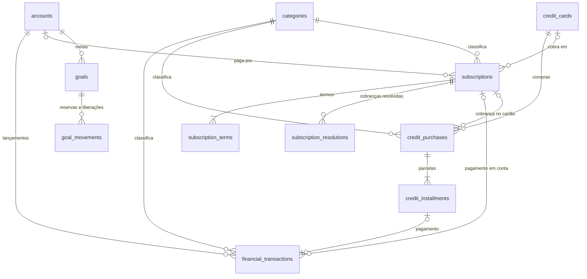

# Modelo de dados

Banco Room `FluxaDatabase`, **versão 7**, em SQLite no armazenamento interno do app. Os schemas de cada versão estão em [`android/app/schemas`](../android/app/schemas/com.fluxa.personal.data.database.FluxaDatabase).

## Diagrama

## Tabelas

| Tabela | Conteúdo | Campos principais |
| --- | --- | --- |
| `accounts` | Contas | `type` (CHECKING, WALLET, SAVINGS), `openingBalanceCents`, `openingDate`, `includeInAvailable`, `archivedAt` |
| `categories` | Categorias | `kind` (INCOME, EXPENSE), `icon`, `color`, `archivedAt` |
| `financial_transactions` | Receitas e despesas realizadas | `direction`, `amountCents`, `occurredOn`, `cancelledAt`, vínculos opcionais `installmentId` ou `subscriptionId` + `occurrenceDate` |
| `credit_cards` | Cartões | `totalLimitCents`, `closingDay`, `dueDay`, `archivedAt` |
| `credit_purchases` | Compras no cartão | `totalCents`, `installmentCount`, `purchaseDate`, `firstDueDate`, `cancelledAt`, vínculo opcional com uma cobrança de assinatura |
| `credit_installments` | Parcelas | `number`, `amountCents`, `dueDate`, `status` (PENDING, PAID, CANCELLED) |
| `subscriptions` | Assinaturas | `frequency`, `anchorDate`, `billingDay`, `status`, origem `accountId` **ou** `cardId` |
| `subscription_terms` | Valor, categoria e origem por período | `effectiveOn`, `enabled` |
| `subscription_resolutions` | Cobranças resolvidas | `occurrenceDate`, `status` (PAID, CHARGED, SKIPPED…), `resultId` |
| `goals` | Metas | `targetAmountCents`, `targetDate`, `accountId`, `completedAt`, `archivedAt` |
| `goal_movements` | Reservas e liberações | `type` (ALLOCATE, RELEASE), `amountCents`, `occurredOn` |
| `local_schema_marker` | Marca técnica do banco | — |

## Tipos de coluna

- **Valores**: `INTEGER` em centavos (`…Cents`).
- **Datas financeiras**: `INTEGER` com o dia em *epoch day* (`LocalDate.toEpochDay()`), como `occurredOn`, `dueDate` e `purchaseDate`.
- **Instantes** (`createdAt`, `updatedAt`, `cancelledAt`, `archivedAt`…): texto ISO-8601.
- **Identificadores**: UUID em texto.
- **Enums**: texto com o nome da constante.

## Integridade

**Chaves estrangeiras** com `ON DELETE RESTRICT` em todos os vínculos. Nada é apagado em cascata, e o app arquiva em vez de apagar.

**Índices únicos que impedem duplicidade**
- `financial_transactions(installmentId)`: no máximo uma despesa por parcela.
- `financial_transactions(subscriptionId, occurrenceDate)`: no máximo um pagamento em conta por cobrança.
- `credit_purchases(subscriptionId, occurrenceDate)`: no máximo uma cobrança no cartão por cobrança.
- `credit_installments(purchaseId, number)`: numeração única das parcelas.

**Triggers** (barreira extra, além das regras em Kotlin)
- `category_kind_guard`: impede trocar entrada por saída em uma categoria já usada.
- Guardas de assinatura: origem coerente (conta **ou** cartão), identidade de cobranças e vínculos válidos.
- `goals_validate_*`: nome não vazio e alvo positivo.
- `goal_movements_validate_insert`: tipo válido e valor positivo.
- `goals_preserve_account`: a conta de uma meta não muda depois do primeiro movimento.

## Dados derivados (não armazenados)

| Valor | Calculado a partir de |
| --- | --- |
| Saldo da conta | saldo inicial + lançamentos não cancelados desde a abertura |
| Saldo disponível | saldos − reservas, das contas ativas incluídas |
| Limite usado do cartão | parcelas pendentes |
| Reservado em uma meta | movimentos de reserva e liberação |
| Cobranças futuras de assinatura | termos + calendário + resoluções |
| Limite seguro, projeção e análises | todos os anteriores, no momento da leitura |

## Migrations

O app nunca usa `fallbackToDestructiveMigration`. Cada versão tem uma migration explícita em [`data/database/migration`](../android/app/src/main/java/com/fluxa/personal/data/database/migration):

| Migration | O que adiciona |
| --- | --- |
| 1 → 2 | Contas e categorias |
| 2 → 3 | Lançamentos |
| 3 → 4 | Cartões, compras e parcelas |
| 4 → 5 | Vínculo de pagamento de parcela (índice único) |
| 5 → 6 | Assinaturas, termos e resoluções |
| 6 → 7 | Metas, movimentos e suas guardas |

Os testes instrumentados abrem bancos em cada versão a partir dos schemas exportados e migram até a 7 (`RcMigrationChainTest` e os testes em `androidTest/.../data/database`).

## Onde ficam os dados

- Banco: `/data/data/com.fluxa.personal/databases/`, acessível só ao app.
- Preferências (DataStore): tema, ocultar valores e configurações de segurança, também no armazenamento interno do app.
- `android:allowBackup="false"` e regras de extração que excluem tudo: o Android não copia esses dados para a nuvem nem para outro aparelho.

O banco **não é criptografado pelo app**. A proteção vem do isolamento entre apps e da criptografia de armazenamento do próprio Android. Veja [BACKUP_AND_SECURITY.md](BACKUP_AND_SECURITY.md).
